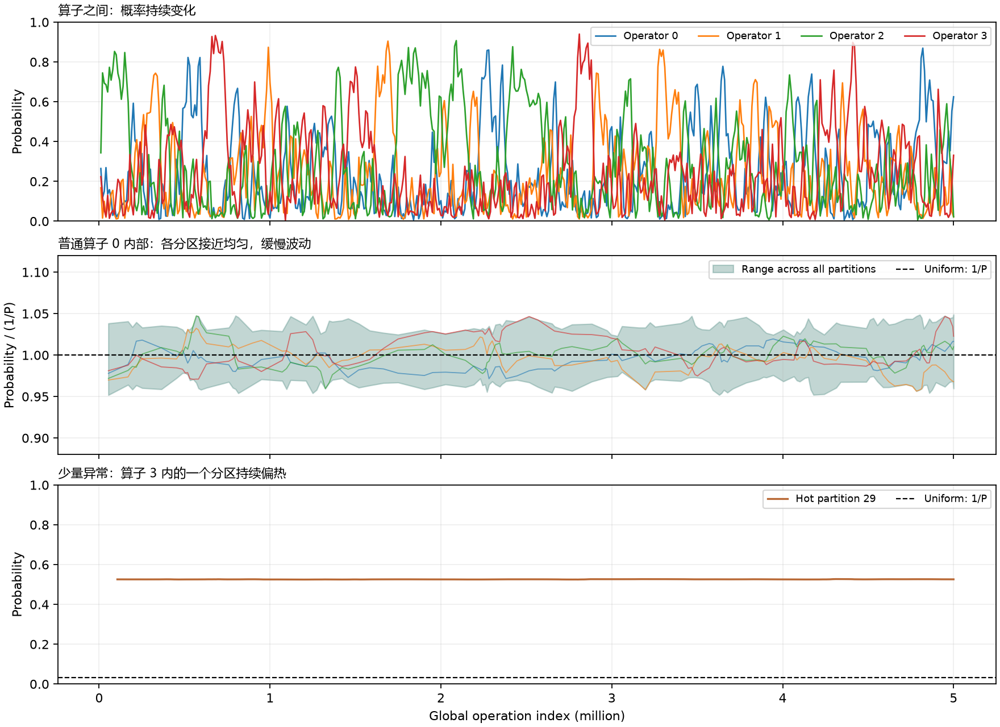

# dyna_dataset：动态热度倾斜数据集

版本 **1.0.0**，冻结于2026-10-30。12个实际用例，每例500万次操作，共 **6000万次操作**；6 train、3 dev、3 holdout。压缩文件合计386.13 MB（原始1.171 GB），可直接下载下表中的 `.txt.gz` 并解压使用。

## 数据特点

算子活跃概率持续变化，分区也各自维护概率与变化驱动力。算子间变化较大；普通算子内部大部分时间接近均匀、缓慢小幅变化，三个指定场景各有一个持续偏热或偏冷分区。每个算子、每个分区的实际出现次数均由采样决定，没有Build/Probe次数配额；固定全局总操作数和阶段时点，文件头在结束后回填真实计数。

分区过程最终速度系数为 `.0025`。它使用本算子的本地访问时钟，算子过程使用全局时钟；二者的变化率不可不加说明地直接比较。全体输入为合成数据，不声称代表官方隐藏分布。

图取自 `train_slow_shared_01` 的冻结轨迹，显示窗口平均采样概率，**不是实际访问频率**；中图为普通算子的全部分区范围与部分分区曲线，下图为另一算子的持续热点。来源指纹见 [图来源](provenance/plot_provenance.json)。

## 下载与划分

| 压缩输入 | 划分 | K / P | 算子变化档位 | 稀有异常 | 压缩MB |
| --- | --- | ---: | --- | --- | ---: |
| [train_slow_shared_01](archives/train_slow_shared_01.txt.gz) | train | 4 / 32 | slow | hot | 29.97 |
| [train_slow_staggered_02](archives/train_slow_staggered_02.txt.gz) | train | 8 / 64 | slow | none | 33.28 |
| [train_fast_shared_03](archives/train_fast_shared_03.txt.gz) | train | 2 / 64 | fast | none | 30.78 |
| [train_fast_staggered_04](archives/train_fast_staggered_04.txt.gz) | train | 8 / 64 | fast | none | 35.06 |
| [train_burst_shared_05](archives/train_burst_shared_05.txt.gz) | train | 8 / 64 | burst | none | 33.71 |
| [train_burst_staggered_06](archives/train_burst_staggered_06.txt.gz) | train | 4 / 64 | burst | none | 30.34 |
| [dev_slow_staggered_07](archives/dev_slow_staggered_07.txt.gz) | dev | 8 / 64 | slow | cold | 31.89 |
| [dev_fast_shared_08](archives/dev_fast_shared_08.txt.gz) | dev | 8 / 64 | fast | none | 33.46 |
| [dev_burst_staggered_09](archives/dev_burst_staggered_09.txt.gz) | dev | 2 / 32 | burst | none | 29.88 |
| [holdout_slow_shared_10](archives/holdout_slow_shared_10.txt.gz) | holdout | 8 / 64 | slow | none | 34.66 |
| [holdout_fast_staggered_11](archives/holdout_fast_staggered_11.txt.gz) | holdout | 4 / 32 | fast | none | 30.31 |
| [holdout_burst_shared_12](archives/holdout_burst_shared_12.txt.gz) | holdout | 8 / 64 | burst | hot | 32.80 |

点击所需文件后选择下载原始文件。解压得到 `.txt`，若按原生成清单恢复布局，将它放到 `data/<split>/<case_id>.txt`。`manifest.json` 给出这些路径、每个原文件及压缩文件的SHA-256；`dataset.json`给出本发布版本与全体输入身份。

## 源码与审核

- [生成说明与复现命令](source/README.md)、[生成器](source/generator.cpp)、[冻结配置](source/config.json)、[批次脚本](source/run_batch.py)、[生成器测试](source/test_generator.py)。源码原字节保留，重新生成需先按说明编译；生成输出位于source脚本所在目录。
- [独立完整审核](audit/report.json)：12/12、6000万次操作全部有效；另有 [概率质量汇总](audit/quality_summary.json)、[审核源码](audit/audit.cpp)和[模型边界检查](audit/source_review.md)。不含平台二进制。
- `metadata/`：每例头部与分区字节、实际计数，以及全局算子窗口和分区本地访问窗口。概率轨迹仅用于数据审核，不能作为在线策略额外观测。
- [发布文件清单](publication_manifest.json)：原研究路径、原件SHA与公开SHA；仅清理少数元数据中的本机路径，12份压缩输入、生成源码和原生成清单保持字节不变。

发布前重新核对12份压缩文件SHA并完整解压计算SHA，全部与独立审核绑定的原始输入一致；不重新生成、不运行策略。原始数据未重复上传，解压即可恢复完整输入。

## 使用边界与修订

本目录位于datasets分支根目录，独立版本1.0.0；默认评测器不会自动把它加入 `datasets/<成员>/eval`。既有成员数据、VERSION和默认榜单不变。使用子集时记录实际用例、输入SHA和本版本；不必等待所有成员上传才能评测。

R71 v1固定Probe配额会造成强制单算子尾部；open-v2虽取消该配额，但仍不满足后来新增的分区概率漂移要求。本版R72按新建模要求统一修订，未按策略成绩择优。早期 `.025` 分区速度未满足慢变层次，在主批生成与性能评测前统一改为 `.0025`。R71与R72沿用相同基础seed和split，属于配对修订，不能当新增独立样本或跨split混用；不在此重复上传旧版大数据。

holdout三例没有参与此次六用例策略抽样评测或拟合；但数据现已公开，不据此声称它对所有后续使用者仍是未知盲测。完整方法成绩另由正式报告提供，本目录不把数据合法性审核当成策略效果证明。
